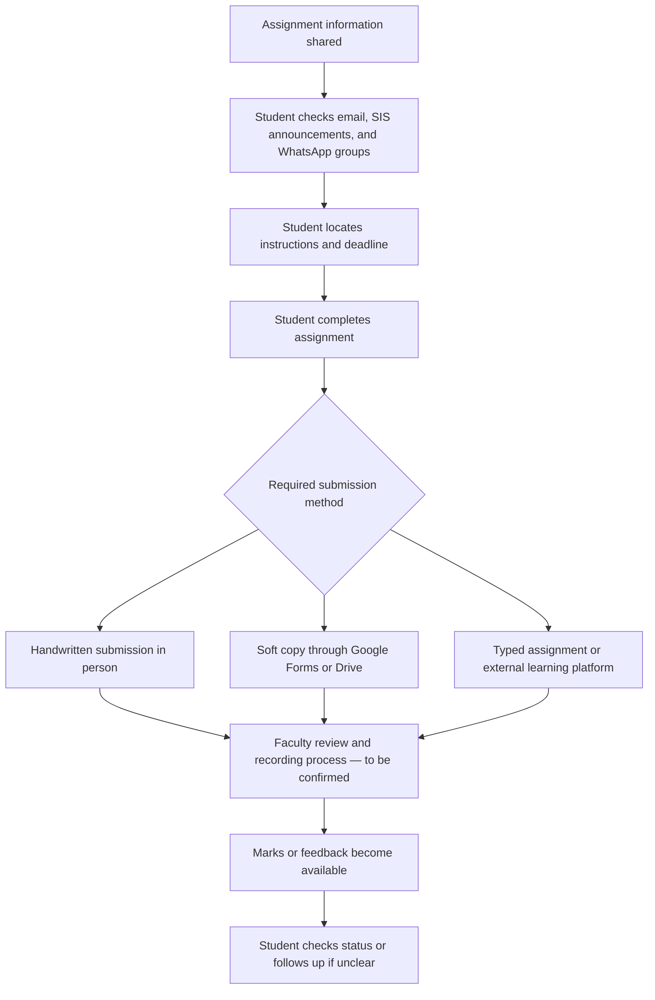
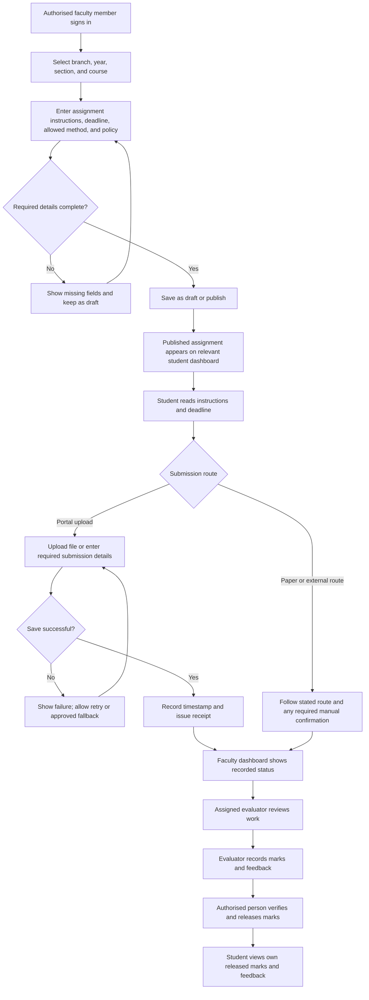

# Task 1 — Process Maps

## Purpose and evidence limits

This document maps the current student-facing assignment workflow and proposes a more consistent workflow for assignment publication, submission tracking, review, and marks release.

The current-state description is based on my personal student experience and informal observations. I have not yet interviewed a teacher or process owner, received permission for formal fieldwork, or conducted a formal student survey or time study. The faculty-side steps in the current-state map are therefore provisional and must be confirmed. If access remains unavailable, treat those steps as a hypothetical walkthrough rather than verified observations.

## 1. Current workflow (As-Is)

### Observed pain points

- Assignment instructions and links may be spread across email, SIS announcements, and WhatsApp groups.
- Submission methods vary by course and assignment. Examples from my experience include handwritten work submitted in person, soft copies through Google Forms or Drive, and work linked to external learning platforms.
- Students may not have one consistent place to check whether a submission was received, reviewed, graded, or released.
- The timing of marks and feedback availability varies in my experience; sometimes marks are posted promptly, while at other times students wait or follow up.
- A missing digital record does not necessarily mean that a student failed to submit. Paper and external-platform submissions may require a separate confirmation process.

These are personal experience and informal observations, not results from a formal survey. The frequency and scale of each issue still need to be measured.

## 2. Proposed workflow (To-Be)

**Important scope boundary:** this is a proposed workflow, not a claim that a working system already exists. It does not assume integration with the university SIS, Google Drive, or external learning platforms. If those systems cannot be integrated with permission, the dashboard should clearly show the external submission route and any manual confirmation requirement.

## 3. Roles and accountability

| Activity                                             | Proposed accountable role                        | Boundary or control                                                             |
| ---------------------------------------------------- | ------------------------------------------------ | ------------------------------------------------------------------------------- |
| Create and publish an assignment                     | Authorised faculty member                        | Can publish only for assigned course/section; required fields must be complete  |
| Submit work                                          | Student                                          | Can view relevant assignments and their own submission records                  |
| Confirm paper or external submission, where required | Faculty member or designated staff member        | Must record confirmation only after checking the applicable source or process   |
| Review assignment                                    | Assigned evaluator                               | Can access submissions for assigned course/section                              |
| Enter marks and feedback                             | Assigned evaluator or authorised faculty member  | Changes should be recorded in an audit history                                  |
| Release marks and feedback                           | Person authorised under the institution's policy | Entry and release may be separate steps if policy requires it                   |
| View marks and feedback                              | Individual student                               | Can view only their own released results                                        |
| Resolve technical issues                             | Designated support contact                       | Should not gain assessment access merely because they provide technical support |

This accountability model is a recommendation. Actual roles, approval rules, and separation of duties must be confirmed with the institution before implementation.

## 4. Status model

### Assignment status

- **Draft:** Saved but not visible as a published assignment to students.
- **Published:** Instructions and deadline are available to the intended students.
- **Closed:** The configured submission window has ended; late submissions are handled according to the stated policy.
- **Archived:** Retained for reference and audit, but no longer active.

### Submission and assessment status

- **No submission recorded:** The system has no recorded submission. This does not prove that the student did not submit through paper or an external route.
- **Submitted:** A submission has been recorded.
- **Submitted late:** A submission was recorded after the configured deadline, if the policy permits recording it.
- **Under review:** An evaluator is reviewing the work.
- **Returned for correction:** The work has been returned where correction or resubmission is allowed.
- **Resubmitted:** A new permitted version has been recorded, with prior history retained.
- **Graded:** Marks and/or feedback have been entered but may not yet be visible to the student.
- **Released:** Marks and feedback have been authorised for student viewing.

The interface should distinguish **Graded** from **Released** so students are not told that marks are available before they have actually been released.

## 5. Exceptions and recovery paths

### 1. Assignment details are incomplete

- **Expected behaviour:** Prevent publication and identify the missing required fields.
- **Recovery:** The faculty member corrects the draft and retries publication.

### 2. Student uploads an unsupported or missing file

- **Expected behaviour:** Display a clear validation message before accepting the submission.
- **Recovery:** The student selects the correct file or completes the missing information and retries.

### 3. Student submits twice

- **Expected behaviour:** Flag a possible duplicate and retain the submission history.
- **Recovery:** Apply the configured resubmission policy. Do not silently overwrite earlier work.

### 4. Student tries to view another student's marks

- **Expected behaviour:** Deny access and record the unauthorised attempt where appropriate.
- **Recovery:** Direct the user to the authorised access or support process. Do not reveal the other student's information.

### 5. Portal upload or database save fails

- **Expected behaviour:** Do not show a successful receipt unless the submission record has actually been saved.
- **Recovery:** Allow the student to retry and provide the approved alternative submission route if the failure continues.

### 6. Paper or external submission has no portal receipt

- **Expected behaviour:** Show the required submission route and explain that portal tracking may depend on manual status entry.
- **Recovery:** The student follows the stated route and contacts the designated person if confirmation is required.

### 7. Marks are entered but not released

- **Expected behaviour:** Show a status such as **Graded**, rather than **Released**.
- **Recovery:** The authorised person completes the release step according to institutional policy.

### 8. A student disputes a status or mark

- **Expected behaviour:** Preserve the existing record and provide a defined review route.
- **Recovery:** Authorised staff verify the submission and assessment record, then document any approved correction.

## 6. Design principles

- Provide one clear view of assignment instructions, deadlines, submission routes, and available status information.
- Show the responsible person or role for each step where practical.
- Issue a submission receipt only after successful saving or confirmed recording.
- Do not treat the absence of a portal record as proof of non-submission when paper or external routes are allowed.
- Make late-submission and resubmission rules configurable rather than assuming one policy for every course.
- Enforce role-based access so students see only their own marks and evaluators see only the work they are authorised to assess.
- Keep an audit history for important actions, such as submission changes, mark updates, and release.
- Provide a clear recovery route for technical failures and users who cannot complete an online step.
- Avoid claiming integrations with existing university systems unless they have been authorised, implemented, and tested.
- Validate the proposed workflow with students, faculty, and relevant support staff before deciding whether to build it.

## 7. Validation still required

No teacher or process owner has yet confirmed the faculty-side workflow. No formal student survey, timed observation, or system test has been completed for this report. The following questions should be checked if access is granted:

1. Who creates and distributes assignment instructions, and which channels are officially approved?
2. Which submission methods are allowed for each type of assignment?
3. Who confirms receipt of paper or external-platform submissions, and how is that confirmation recorded?
4. Who enters marks, who releases them, and are these separate responsibilities?
5. What are the official rules for late submissions, resubmissions, corrections, and disputes?
6. What should students do when an upload or existing platform fails?
7. Which existing systems, if any, already provide these functions, and what would a new dashboard add?

If access remains unavailable, the faculty-side workflow and proposed role boundaries must remain explicitly labelled as hypothetical or recommended. They must not be presented as confirmed institutional practice.

## Connection to the Capstone Lab

The proposed workflow and design principles in this document form the basis of the Assignment Submission and Review Management System described in Task 2's `capstone-lab.md`. In particular, the assignment publication, successful-submission confirmation, review, grading, release, access-control, and failure-recovery steps are translated into proposed application features and test cases. The capstone remains a proposal until the relevant features are implemented and tested.
