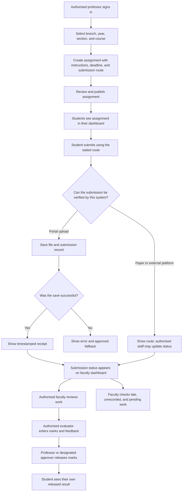

# Task 1 — A Unified Assignment and Assessment Management Workflow

## 1. Executive summary

The assignment and assessment process can be unpredictable for students. Assignment announcements may be shared through email, SIS announcements, or WhatsApp groups, while submission methods vary between paper, Google Forms/Drive, and external learning platforms. Assessment records and marks are not always available to students at the same time: some professors release marks promptly, while other assessments may remain unclear until later in the semester or require students to follow up.

This creates avoidable uncertainty. Students may have to search across channels, check whether work was received, and follow up about missing or unclear marks. From a student perspective, a course-wise overview could also help faculty identify submissions that have not yet been recorded and assessments still awaiting review or mark release.

This report proposes a **Unified Assignment and Assessment Management System**: one organised application structured by branch, year, section, and course. It would bring assignment instructions, due dates, submission routes, submission status, assessment status, marks, and feedback into one place. It would also provide a faculty dashboard for tracking submissions and pending assessment work. Existing official systems can remain the source of truth where required, with links or approved data exchange rather than unplanned duplication.

**Evidence limitation:** this is a preliminary, student-perspective workflow study. I have not yet confirmed the process with a teacher or other process owner, and I have not conducted a formal survey or measured the time spent on follow-ups. Student-side experiences described here are based on my own experience and informal conversations. Faculty-side steps and the proposed system are therefore design assumptions to validate, not confirmed descriptions of every course's internal process. If access to a process owner is unavailable, this report will remain explicitly labelled as a preliminary/hypothetical walkthrough.

The aim is not to criticise individual professors. The issue is that the overall process can vary between courses. A shared workflow with clear statuses could make it more predictable for students and easier to manage for faculty, provided that the extra system does not create more work than it saves.

## 2. Scope, evidence, and investigation method

### Scope

The workflow selected for this task is:

**Assignment announcement → submission → review → marks/feedback release.**

The proposed scope covers how students find assignment instructions, identify the correct submission method, understand whether a submission has been recorded, and check the status of marks or feedback. It also considers what a faculty-facing overview would need to show. It does not assume that every course uses the same submission method or grading policy.

### Evidence currently available

- **Personal student experience:** assignment instructions may be shared across email, SIS announcements, and WhatsApp groups.
- **Different submission routes:** some work is submitted on paper, some through Google Forms/Drive, and some through external learning platforms or course-linked services.
- **Different mark-visibility experiences:** marks may appear promptly for some assessments, while for others students may wait or need to follow up.
- **Informal conversations:** I recall other students expressing similar concerns. These conversations were informal and were not a structured or counted survey, so no percentage or survey result is claimed.

### Limitations and next validation step

I have **not yet asked a teacher or process owner for permission to observe or discuss the workflow**. No faculty interview, formal survey, time study, or live-system inspection is claimed in this report. As a result, the student-facing pain points are preliminary observations, while internal faculty steps, approval boundaries, and administrative practices remain unconfirmed.

The next validation step would be to request permission from an appropriate teacher or process owner and ask them to confirm the current steps, who is responsible at each handoff, how paper/external submissions are recorded, who enters and releases marks, and what exceptions commonly occur. If permission is not granted or no response is received before submission, the workflow will be presented as a hypothetical walkthrough based on the student perspective, with assumptions clearly marked. No private student data is needed for this study.

## 3. Problem statement

Students do not always have one reliable place to check what work has been assigned, where it must be submitted, whether it has been received, and when marks or feedback will be available. Different professors may use different channels and follow different timelines. This can make students miss announcements, feel uncertain about submission status, or need to ask for updates.

A possible corresponding management problem for faculty is the effort required to identify missing submissions, late work, unreviewed assessments, and marks that have not yet been released. This faculty-side issue is a hypothesis to confirm with a process owner rather than a measured finding.

The proposed system aims to make assignment and assessment status visible and organised, while leaving academic decisions—grading, deadlines, extensions, and release approval—with authorised faculty.

## 4. Objectives

1. Provide one organised view of assignments and assessment information.
2. Organise records by branch, year, section, course, and assessment.
3. Make deadlines and submission methods clear.
4. Track submitted, late, missing-record, under-review, graded, and released statuses.
5. Help authorised faculty identify submissions and assessments that need attention.
6. Present marks with the correct course, assessment name, maximum marks, release status, and feedback where available.
7. Reduce avoidable student follow-ups and repetitive status checking.
8. Protect student records through role-based access and an audit trail.
9. Check whether the proposed workflow saves enough time to justify data-entry, support, and maintenance effort.

## 5. Current workflow and pain points

### Preliminary student-perspective workflow

Based on the student experience available for this project, the process can look like this:

1. A student notices an assignment announcement in email, an SIS announcement, a WhatsApp group, or another course channel.
2. The student checks the instructions, due date, and required submission method.
3. The student submits the work through the specified route—for example, physically, through Google Forms/Drive, or through an external learning platform.
4. The student may need to check the relevant channel or platform to understand whether the work was received or recorded.
5. The student later checks for marks or feedback and may follow up if the status is unclear.

This is a preliminary description of student experience, not a verified process map for every course. The exact steps and systems may differ by professor, course, and assessment.

### Pain points to validate

| Potential friction point                                    | Possible effect on students                                       | Faculty-side implication to validate                                                  |
| ----------------------------------------------------------- | ----------------------------------------------------------------- | ------------------------------------------------------------------------------------- |
| Announcements spread across channels                        | More searching and a risk of missing instructions or deadlines    | Repeated questions about assignment details may occur                                 |
| Different submission methods                                | Uncertainty about the correct route and whether work was received | Submission records may need to be checked across different routes                     |
| No single course-wise submission overview                   | Students may not know whether work is pending, late, or recorded  | It may take extra effort to identify late submissions or submissions not yet recorded |
| Different visibility/timing for marks and feedback          | Students may follow up to understand results or pending status    | Repeated status requests may interrupt other work                                     |
| Assessment records are not presented in one consistent view | Harder to connect a mark with a specific assessment               | A consolidated view may help identify work awaiting review, grading, or release       |

The faculty-side implications in the table are **questions/hypotheses for validation**, not confirmed findings. The goal is to make the process more consistent, not to force every professor to change grading judgement or academic policies.

## 6. Proposed system

### A. Student dashboard

Each student signs in and sees only the courses and assessments relevant to their branch, year, section, and enrolment.

The dashboard includes:

- Assignment title and course.
- Instructions and attachments.
- Due date and submission method.
- Official link where submission happens elsewhere.
- Submission status and timestamp, where the system can verify it.
- Assessment name, maximum marks, released marks, and feedback.
- Clear labels for marks that are not yet released.

### B. Faculty dashboard

Authorised faculty can select a branch, year, section, and course, then view the relevant assignments and student list, subject to institutional permissions.

For each assessment, the dashboard can show:

- Submissions recorded.
- Submissions recorded as late.
- Records awaiting review.
- Marks entered but not yet released.
- Released marks and feedback.
- Records for which no submission has been recorded.
- A downloadable summary for record keeping, if permitted by institutional rules.

“No submission recorded” must not automatically mean that a student did not submit. This is especially important where paper submissions or external platforms are used and the status may not yet have been entered into the proposed system.

### C. Assignment creation and publication

An authorised professor or course owner creates an assignment entry with the course, branch/year/section, instructions, due date, allowed format, and submission route. The authorised owner reviews and publishes it. Students in the selected group can then see it in their dashboard.

**Approval boundary:** the system can organise and display assignment information, but it must not independently change academic deadlines, approve extensions, impose late penalties, or publish an assignment without the required faculty approval.

### D. Submission tracking

For uploads handled directly by the application, the system records a submission only after the file and submission record have been saved successfully. It then shows a timestamped receipt.

For paper submissions or external platforms, the application displays the correct instructions and may show a status entered by authorised staff. It must not claim to verify an external submission unless an approved integration actually exists.

### E. Marks and feedback

The professor or authorised evaluator records marks and feedback against the named assessment. The authorised faculty member controls when marks are released. Students can see only their own released results. Changes to marks or release status should be recorded in an audit log.

The system may display an expected release date if the course owner has approved one. It should not invent a universal grading deadline or automatically penalise students.

## 7. Improved workflow and handoffs

The following is the **proposed workflow**, not a claim that the current process has already been verified with faculty.

### Ownership and approval boundaries

| Step                                    | Proposed accountable owner                                  | Boundary or control                                                                                                 |
| --------------------------------------- | ----------------------------------------------------------- | ------------------------------------------------------------------------------------------------------------------- |
| Create and publish assignment           | Professor/course owner                                      | Must confirm course, target section, instructions, deadline, and submission route before publishing                 |
| Submit work                             | Student                                                     | Student follows the specified route; a receipt is shown only if the application successfully records the submission |
| Record paper/external submission status | Authorised staff, if the course chooses to use this feature | The dashboard must distinguish a manually entered status from an automatically verified upload                      |
| Review work                             | Professor/assigned evaluator                                | The system tracks status; it does not make academic judgements                                                      |
| Enter marks and feedback                | Authorised evaluator                                        | Access is limited to assigned assessments and changes are auditable                                                 |
| Release marks                           | Professor or designated approver                            | Marks remain hidden from students until explicitly released by an authorised person                                 |
| Manage user/course mappings             | Authorised academic administrator                           | Changes require permission and should be logged                                                                     |
| Maintain application                    | System administrator                                        | Technical maintenance should not grant unnecessary access to marks or feedback                                      |

## 8. Roles and access control

- **Student:** views assigned courses, their own submission records, and their own released marks.
- **Professor/course owner:** creates and publishes assignments, reviews submissions, and manages course assessment status.
- **Authorised evaluator:** enters marks and feedback for assigned assessments.
- **Academic administrator:** manages course/section mappings and authorised roles according to institutional policy.
- **System administrator:** maintains the application but should not gain unnecessary access to grade content.

Permissions must be enforced on the server, not merely by hiding information in the interface. Students must not be able to view another student's submissions or marks. Mark changes, status overrides, and releases should record who performed the action and when. Access should follow institutional policy and be limited to the minimum necessary.

## 9. Status model

### Assignment status

- Draft
- Published
- Closed
- Archived

### Submission status

- No submission recorded
- Submitted
- Submitted late
- Under review
- Returned for correction
- Resubmitted
- Graded
- Released

The course owner configures permitted states and resubmission rules within institutional policy. “No submission recorded” must not be treated as proof of non-submission when a paper or external submission has not yet been entered into the system. “Graded” and “Released” are separate: a mark can be entered without being visible to the student until an authorised person releases it.

## 10. Technical approach

A practical prototype could use:

- **Frontend:** HTML, CSS, and JavaScript.
- **Backend:** Python with Flask.
- **Database:** relational tables for users, course/section membership, assignments, submissions, marks, and audit events.
- **File handling:** controlled storage with file-type/size validation and safe access.
- **Authentication and permissions:** role-based access for students, professors, evaluators, and administrators.

The prototype can use synthetic students, courses, assignments, files, and marks. It does not require live SIS integration to demonstrate the core workflow. In a real deployment, integration, data ownership, retention, security review, and operating responsibility would need institutional approval. The prototype should not be presented as an official IFHE system.

## 11. Failure handling and practical constraints

- **Upload fails:** do not show a success receipt; show an error and a safe retry or approved fallback.
- **Database/storage unavailable:** do not silently lose the submission; display the failure and provide the approved alternative route. Do not claim a submission was saved if it was not.
- **External platform used:** show the correct link and instructions; do not falsely claim automated verification.
- **Paper submission:** allow authorised staff to record receipt if the course and institution approve this feature.
- **Wrong section/course mapping:** restrict publication to the selected class and provide a review step before publishing.
- **Unauthorised marks access:** deny the request and log the attempt where appropriate.
- **Duplicate submission or data entry:** identify the official source for each field, prevent accidental duplicate records where possible, and avoid creating a conflicting second gradebook.
- **Different course policies:** allow authorised course-level settings within institutional rules rather than imposing one automatic late penalty.
- **No faculty adoption or unclear ownership:** do not assume the system will be used; first confirm who would maintain records and whether the dashboard fits the existing process.

## 12. Synthetic test plan

The five cases in `test-cases.md` cover a normal submission, missing information, duplicate submission, an unauthorised attempt to access another student's marks, and storage/database failure. They specify expected behaviour and recovery for a future prototype.

**Execution status:** these are planned synthetic tests, not claimed as completed test results. Each case should be marked **Pass** or **Fail** only after it has actually been run, with the observed result and any fix recorded. Testing should use synthetic data only, not real student records or marks.

## 13. Measuring whether it helps

The intended benefits are:

- Less time spent searching for assignment information.
- Fewer repetitive questions about submission and mark status.
- Quicker identification of late submissions and records that need attention.
- Clearer visibility of assessments awaiting review, grading, or release.
- More organised course-level records.

A pilot should measure student and faculty time separately. Useful measures include the number of status-related follow-ups, average time per follow-up, time spent compiling missing-submission lists, number of submission disputes, and the extra time required to maintain the dashboard. Baseline and pilot periods should be comparable, and any collected information should be approved and handled without exposing private student details.

The net time-saving calculation should account for both the time potentially saved and the additional time needed for review, data entry, support, and maintenance:

**Net time saved = gross time saved − added review/support/maintenance time.**

`calculations.md` contains illustrative low, middle, and high scenarios for follow-up time. The values, reduction percentages, and support effort in those scenarios are planning assumptions, not measured outcomes. They must not be presented as proof of actual savings. The scenarios also do not fully measure implementation, training, or long-term maintenance costs, so the prototype should be expanded only if a real pilot shows that its benefits justify the added workload.

## 14. Conclusion

A unified assignment and assessment management system could make the process more predictable by giving students one place to check instructions, deadlines, submission routes, submission status, marks, and feedback, while giving authorised faculty a course-wise view of recorded submissions and pending assessment work.

The strongest design choices are to organise the workflow by branch, year, section, and course; use clear status labels; define who owns each step; respect faculty authority over grading and release; and avoid duplicate or conflicting records. It should support existing submission methods without pretending to verify paper or external-platform submissions automatically.

This proposal is based on preliminary student-perspective evidence. Teacher/process-owner confirmation, formal measurements, and prototype test execution remain outstanding and must be reported honestly when completed. If access to faculty or live systems is unavailable, the report should remain a clearly labelled hypothetical walkthrough rather than claiming observations or validation that did not occur.

## Connection to Task 2

The workflow analysis in this report informs the proposed Assignment Submission and Review Management System capstone in Task 2. The capstone converts the identified pain points and proposed workflow into functional requirements, access controls, exception-handling scenarios, and planned tests. See `capstone-lab.md` in the Task 2 curriculum folder. The prototype and its tests must be treated as proposed work until implementation evidence is recorded.
